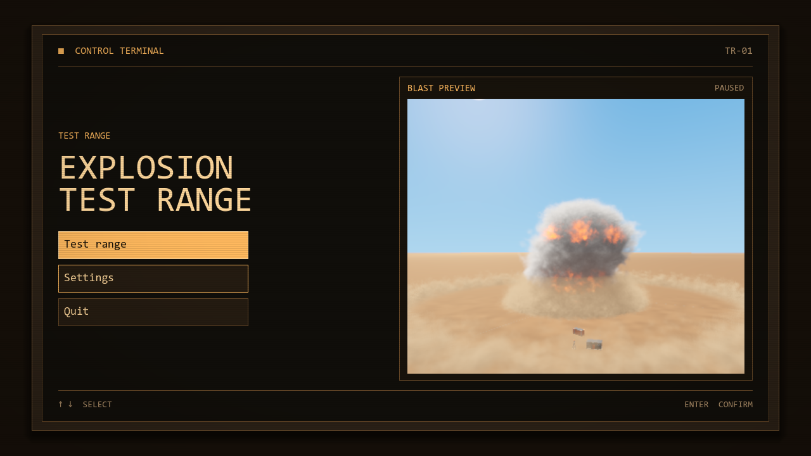

# Explosion Test Range

[Русская версия](README.ru.md)

A 3D visual-effects sandbox built in Godot. Stage fictional explosion effects on a desert test range, slow the simulation down, follow the dust and smoke, or build your own layout with destructible props. Sizes, timings, and damage are authored for gameplay and visual comparison.

## Play

Download the Windows x64 ZIP from [Releases](https://github.com/brainvirginia1-cpu/ExplosionTestRange/releases), extract it, and run **ExplosionTestRange.exe**. The Windows build uses the Forward+ renderer with Direct3D 12 by default. The game supports English and Russian under **Settings → Language**.

The main menu shows a paused 3D explosion. Open the Graphics tab to see changes to render scale, anti-aliasing, lighting, shadows, and volumetric quality in the preview.

## What is inside

- Surface, thermobaric, and underground effects with distinct smoke, dust, sound, and terrain responses.
- An editable range with a 100-object starting layout, placement tools, and local save/load.
- Procedural clouds, volume shadows, airborne shock visuals, weather controls, and distance-dependent audio.
- Free camera, a walkable observer with first- and third-person views, slow motion, and last-trial replay.

## Controls

| Input | Action |
| --- | --- |
| Left click on ground | Set the source or use the selected editor tool |
| Hold right mouse button | Look around |
| Mouse wheel | Zoom in or out |
| WASD · Q / E · Shift | Move · change altitude in free camera · move faster |
| Space · R | Detonate · reset |
| Esc | Pause, open settings, or return to the main menu |
| T · Y | Toggle 1× / ¼× speed · replay the last trial |
| V · B | Enter or leave the observer · toggle first / third person |
| J · H · N | Jump · show injuries · respawn |

## Build from source

Open `project.godot` in **Godot 4.7.2** and press F5. To export, install the matching export templates and select the **Windows Desktop** preset. Blender and Python are only needed when regenerating assets. The project includes the assets it reads at runtime. See [asset sources and regeneration](ASSET_PIPELINE.md).

## License

The project source and original assets use the [MIT License](LICENSE). The bundled thunder recordings are CC0 and retain their [source credits](ASSET_PIPELINE.md). The Windows package includes Godot and its separate notices. [Godot Engine license](https://godotengine.org/license/)
