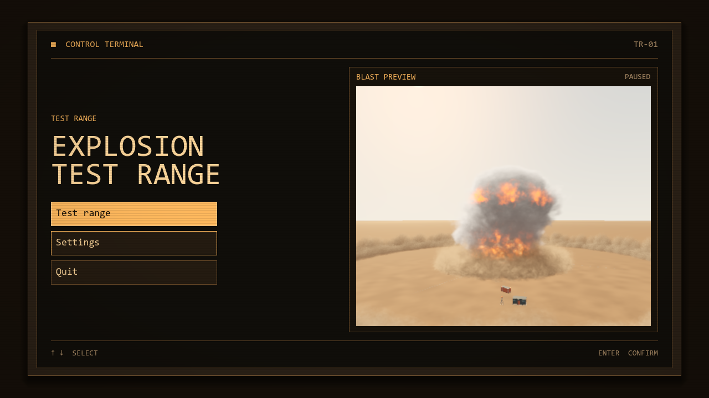

# Explosion Test Range

[English version](README.md)

Трёхмерная песочница визуальных эффектов на Godot. На пустынном полигоне можно менять расстановку объектов, наблюдать за дымом, пылью, ударной волной и разрушениями, а также замедлять или повторять испытание. Размеры, длительность и разрушения настроены для игры и сравнения эффектов.

## Запуск

Скачайте ZIP для Windows x64 из [Releases](https://github.com/brainvirginia1-cpu/ExplosionTestRange/releases), распакуйте его и запустите **ExplosionTestRange.exe**. Godot устанавливать не нужно. Сборка использует Forward+ и Direct3D 12. Русский и английский переключаются в **Настройки → Язык**.

В главном меню справа показан замороженный игровой взрыв. Вкладка «Графика» позволяет сравнивать на этом кадре масштаб рендера, сглаживание, освещение, тени и качество объёмных эффектов.

## Возможности

- Наземные, термобарические и подземные испытания с разными эффектами и звуком.
- Редактор полигона со 100 стартовыми объектами, инструментами размещения, сохранения и загрузки.
- Объёмный дым, пыль и тени, воздушный фронт, погода и пространственный звук.
- Свободная камера и режим наблюдателя с видом от первого или третьего лица.

## Управление

Клавиши можно переназначить через **Настройки → Управление** в главном меню или меню паузы.

| Клавиша | Действие |
| --- | --- |
| ЛКМ по земле | Выбрать точку или применить инструмент |
| Удерживать ПКМ | Повернуть камеру |
| Колесо мыши | Приблизить или отдалить изображение |
| WASD · Q / E · Shift | Двигаться · менять высоту в свободной камере · ускориться |
| Пробел · R | Подрыв · сброс |
| Esc | Пауза, настройки и выход в главное меню |
| T · Y | Переключить 1× / ¼× · повторить испытание |
| V · B | Войти в режим наблюдателя или выйти · сменить вид |
| J · H · N | Прыжок · травмы · возрождение |

## Сборка

Откройте `project.godot` в **Godot 4.7.2** и нажмите F5. Для экспорта установите шаблоны этой версии Godot и выберите пресет **Windows Desktop**. Blender и Python нужны только для повторной генерации ассетов. [Источники и генерация ассетов](ASSET_PIPELINE.md)

## Лицензия

Исходники и оригинальные ассеты распространяются по [MIT](LICENSE). Записи грома распространяются по CC0, ссылки на авторов приведены в [списке ассетов](ASSET_PIPELINE.md). Уведомления о лицензиях Godot входят в архив Windows. [Лицензия Godot](https://godotengine.org/license/)
